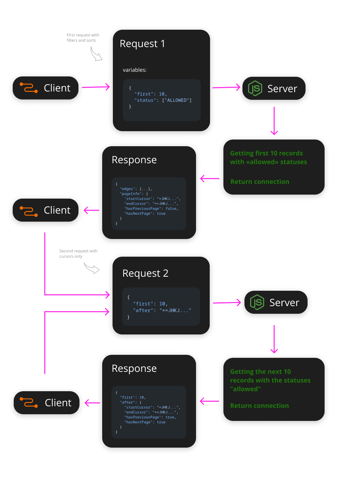

# Пагинация (Connections)

Ядро содержит типы для курсорной пагинации по [спецификации Relay Connections](https://relay.dev/graphql/connections.htm): `NodeInterfaceType`, `EdgeInterfaceType`, `ConnectionInterfaceType`, `PageInfoType`. Для работы с курсорами есть функции `createCursorCodec`, `parseConnectionArgs` и `buildConnection` (с версии 2.12).

## Идея

Курсорная пагинация устроена так:

1. Первый запрос передаёт **критерии** (фильтры, сортировку) и количество записей (`first` или `last`), но без курсора.
2. Каждая запись ответа получает **курсор** — строку, по которой можно продолжить выборку.
3. Следующие запросы передают только курсор (`after` или `before`) и количество. Критерии восстанавливаются из курсора.

Фильтры и сортировка фиксируются в первом запросе, поэтому порядок страниц не меняется при листании.



## Схема

```graphql
type Query {
  users(first: Int, last: Int, after: String, before: String, status: [UserStatus!]): UsersConnection!
}

type User implements Node {
  id: ID!
  name: String!
  status: UserStatus!
}

enum UserStatus { ALLOWED FORBIDDEN }

type UsersConnection implements Connection {
  pageInfo: PageInfo!
  edges: [UserEdge!]!
}

type UserEdge implements Edge {
  node: User!
  cursor: String!
}
```

### Типы на TypeScript

```ts
import {
  GraphQLObjectType,
  GraphQLString,
  GraphQLNonNull,
  GraphQLID,
  GraphQLEnumType,
  GraphQLList,
} from 'graphql';
import {
  NodeInterfaceType,
  EdgeInterfaceType,
  ConnectionInterfaceType,
  PageInfoType,
} from '@via-profit-services/core';

const UserStatus = new GraphQLEnumType({
  name: 'UserStatus',
  values: {
    ALLOWED: { value: 'allowed' },
    FORBIDDEN: { value: 'forbidden' },
  },
});

const User = new GraphQLObjectType({
  name: 'User',
  interfaces: [NodeInterfaceType],
  fields: {
    id: { type: new GraphQLNonNull(GraphQLID) },
    name: { type: new GraphQLNonNull(GraphQLString) },
    status: { type: new GraphQLNonNull(UserStatus) },
  },
});

const UserEdge = new GraphQLObjectType({
  name: 'UserEdge',
  interfaces: [EdgeInterfaceType],
  fields: () => ({
    cursor: { type: new GraphQLNonNull(GraphQLString) },
    node: { type: new GraphQLNonNull(User) },
  }),
});

const UsersConnection = new GraphQLObjectType({
  name: 'UsersConnection',
  interfaces: [ConnectionInterfaceType],
  fields: () => ({
    pageInfo: { type: new GraphQLNonNull(PageInfoType) },
    edges: { type: new GraphQLNonNull(new GraphQLList(new GraphQLNonNull(UserEdge))) },
  }),
});
```

## Курсор

Курсор хранит критерии выборки и позицию записи (`offset`) во всём отфильтрованном списке.

Курсор приходит от клиента, поэтому его нельзя принимать на веру. Курсор в виде base64-JSON клиент раскодирует, поменяет фильтры (например, уберёт «только мой клиент») и закодирует обратно. Поэтому ядро **подписывает** курсоры:

```
eyJzdGF0dXMiOlsiYWxsb3dlZCJdLCJvZmZzZXQiOjR9.kP3x…
└──────── base64url(JSON) ───────────────┘ └ HMAC-SHA256 ┘
```

Содержимое курсора по-прежнему можно прочитать, но изменить его без секрета сервера нельзя: любое изменение даёт ошибку `Invalid cursor`.

```ts
import crypto from 'node:crypto';
import { createCursorCodec } from '@via-profit-services/core';

// Отдельный ключ, выведенный из существующего секрета (например, ключа JWT).
// HKDF с собственной меткой: из ключа курсоров нельзя восстановить ключ JWT.
const cursorKey = Buffer.from(
  crypto.hkdfSync('sha256', config.jwt.privateKey, '', 'my-project-connection-cursor', 32),
);

export const cursorCodec = createCursorCodec({ secret: cursorKey });
```

Секрет должен быть не короче 32 байт, иначе `createCursorCodec` бросит ошибку. Кодек создаётся **один раз** при старте. Если сменить секрет, все выданные курсоры станут недействительными: клиент получит `Invalid cursor` при подгрузке следующей страницы и начнёт листать с начала.

## Аргументы

`parseConnectionArgs` поддерживает четыре формы:

| Аргументы | Что вернётся |
|-----------|--------------|
| `first` | Первые `first` записей |
| `first` + `after` | `first` записей после записи курсора |
| `last` + `before` | До `last` записей перед записью курсора (сама запись курсора не включается) |
| `first` + `offset` | Страница по номеру, без курсоров (админки, таблицы с номерами страниц) |

Всё остальное отклоняется с понятным сообщением: нет ни `first`, ни `last`; переданы оба; переданы и `after`, и `before`; `first` с `before` или `last` с `after`; отрицательные или дробные значения; `first`/`last` больше `maxPageSize`. `null` считается «не передано»: клиенты часто шлют все четыре переменные, а ненужные оставляют `null`.

`last` без `before` («последние N записей всего списка») не поддерживается: для этого нужно знать общее количество записей ещё до запроса.

Все ошибки — `GraphQLError` с `extensions.code = 'BAD_USER_INPUT'`. Это ошибки клиента, поэтому `maskErrors` их не скрывает.

## Фильтры и курсор

Курсор хранит фильтры первой страницы, поэтому следующую страницу клиент запрашивает одним `after`. Но фильтры, которые резолвер передаёт явно (не `undefined`), **важнее** фильтров из курсора:

```ts
const { limit, offset, cursor } = parseConnectionArgs(
  args,
  {
    status: args.status,          // undefined, если клиент не передал: берётся из курсора
    client: [context.user.client] // ограничение сервера: всегда перекрывает курсор
  },
  { codec: cursorCodec, maxPageSize: 100 },
);
```

Ограничения доступа передавайте именно так, из `context`, в каждом запросе. Даже подписанный курсор, выданный другому пользователю, не сможет их заменить.

Фильтры хранятся в курсоре в виде JSON. Поэтому `cursor` возвращается в том же виде и для первой страницы: даты превращаются в строки, ключи со значением `undefined` пропадают (тип `ConnectionCursor<Filters>`).

## Резолвер

```ts
import { parseConnectionArgs, buildConnection } from '@via-profit-services/core';

const usersField = {
  type: new GraphQLNonNull(UsersConnection),
  args: {
    first: { type: GraphQLInt },
    last: { type: GraphQLInt },
    after: { type: GraphQLString },
    before: { type: GraphQLString },
    status: { type: new GraphQLList(new GraphQLNonNull(UserStatus)) },
  },
  resolve: async (_parent, args, context) => {
    // 1. Аргументы → limit, offset и фильтры
    const { limit, offset, cursor } = parseConnectionArgs(
      args,
      { status: args.status },
      { codec: cursorCodec, maxPageSize: 100 },
    );

    // 2. Выборка. lag/lead показывают, есть ли записи до и после страницы:
    //    оконные функции считаются ДО limit/offset, по всей отфильтрованной выборке
    const query = context.knex
      .select(
        'users.*',
        context.knex.raw('lag(??) over (order by ??) as "prev"', ['users.id', 'users.id']),
        context.knex.raw('lead(??) over (order by ??) as "next"', ['users.id', 'users.id']),
      )
      .from('users')
      .where('users.organizationId', context.user.organizationId) // доступ — из контекста
      .orderBy('users.id')
      .limit(limit)
      .offset(offset);

    if (cursor.status) {
      query.whereIn('users.status', cursor.status);
    }

    const rows = limit > 0 ? await query : [];

    // 3. Ответ
    return buildConnection(rows, {
      cursor,
      codec: cursorCodec,
      hasPreviousPage: rows.length > 0 && rows[0].prev !== null,
      hasNextPage: rows.length > 0 && rows[rows.length - 1].next !== null,
    });
  },
};
```

`limit` может быть равен `0`: при `first: 0` или при `before` на первой записи. Не выполняйте запрос в этом случае: в некоторых построителях запросов `limit(0)` означает «без ограничения».

## Переход со своего `BaseService`

Во многих проектах эта логика написана в `BaseService` (`buildConnectionPayload`, `validateConnectionArgs`, `buildConnectionResponse`). Методы можно оставить, заменив их тела вызовами ядра: остальной код проекта не меняется.

```ts
public buildConnectionPayload(existedCursor, args) {
  return parseConnectionArgs(args, existedCursor, { codec: cursorCodec });
}

public validateConnectionArgs(args) {
  parseConnectionArgs(args, {}, { codec: cursorCodec });
}

public buildConnectionResponse(cursor, nodes) {
  return buildConnection(nodes, {
    cursor,
    codec: cursorCodec,
    hasPreviousPage: nodes.length > 0 && nodes[0].prev !== null,
    hasNextPage: nodes.length > 0 && nodes[nodes.length - 1].next !== null,
  });
}
```

Что изменится для клиентов:

- **Старые курсоры без подписи** (base64-JSON) перестанут приниматься. Клиент один раз получит `Invalid cursor` при подгрузке следующей страницы. Первая страница запрашивается без курсора, поэтому её это не затронет.
- `first` + `before` и `last` + `after` теперь отклоняются. Раньше лишний аргумент молча игнорировался.
- Ошибки аргументов приходят как `GraphQLError` с кодом `BAD_USER_INPUT`, а не как внутренние ошибки. С `maskErrors` клиент видит их текст.

Сервисы, которые разбирают `first`/`after` вручную, в обход `buildConnectionPayload`, стоит перевести на `parseConnectionArgs`: в них нет проверки аргументов, а `last` + `before` возвращает лишние записи.

## Пагинация и лимит сложности

`first`, `last`, `limit`, `take`, `pageSize` и `size` по умолчанию считаются [множителями сложности](./configuration.md#complexitylimit): `users(first: 100) { posts(first: 50) { id } }` стоит около 10 000. Ограничивайте размер страницы опцией `maxPageSize` в `parseConnectionArgs` и подбирайте `maxComplexity` под реальные запросы клиентов.

## Limit/offset

Спецификация GraphQL рекомендует курсорную пагинацию, но не требует её. Внутри резолвера курсоры всё равно превращаются в `limit` и `offset`, как в примере выше. Если клиенту курсоры не нужны (админки, отчёты), аргументы `limit`/`offset` допустимы. Клиент [Relay](https://relay.dev) работает только с курсорами.
